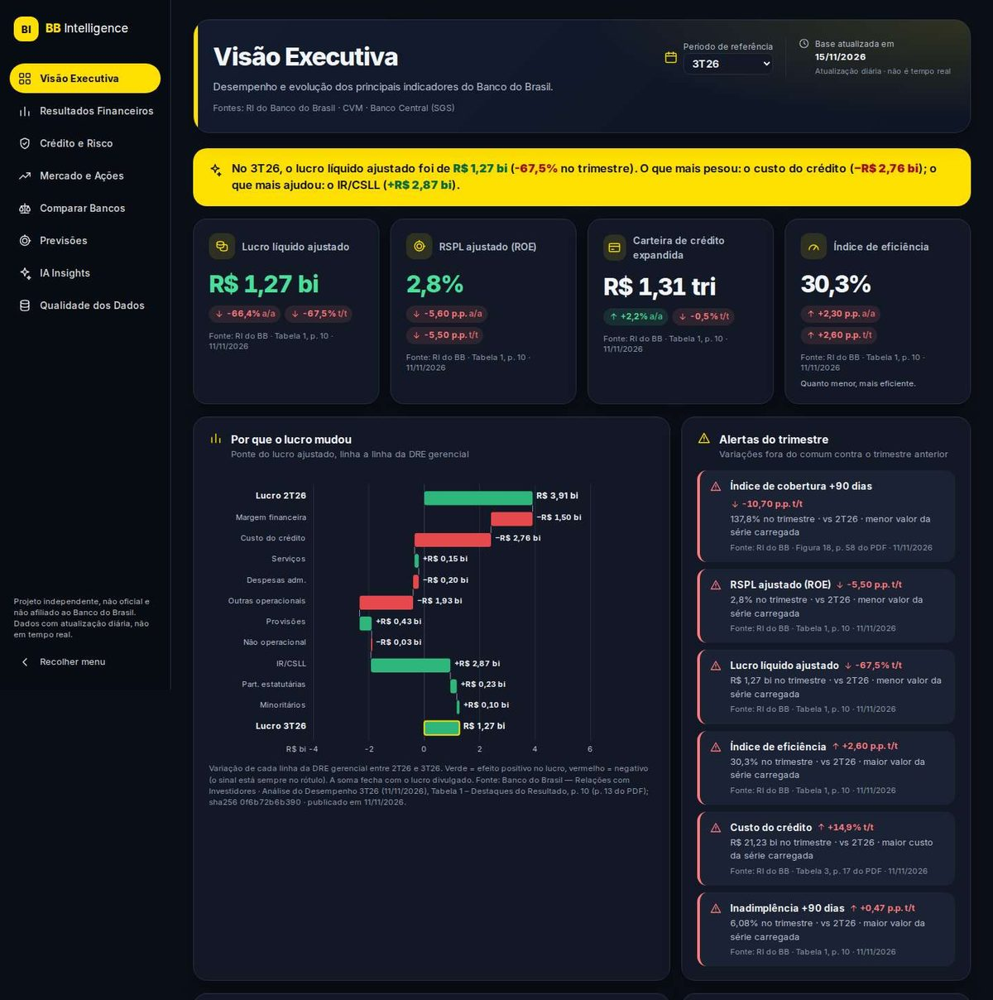
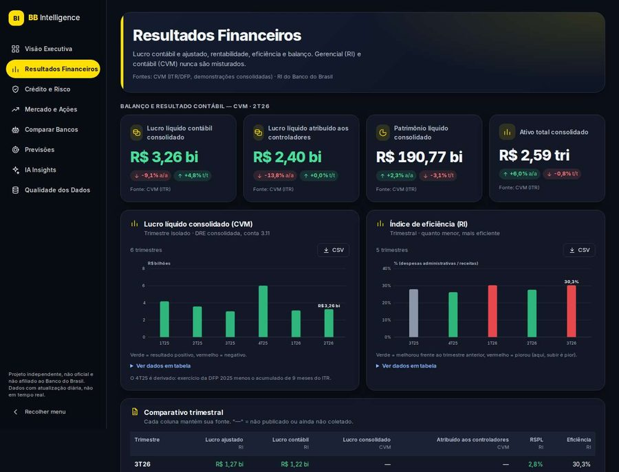
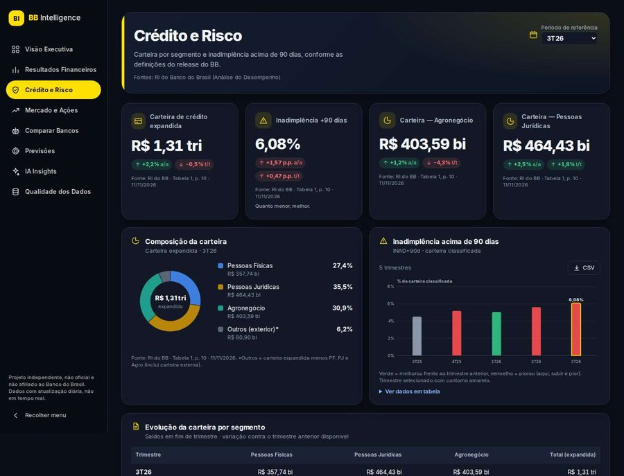
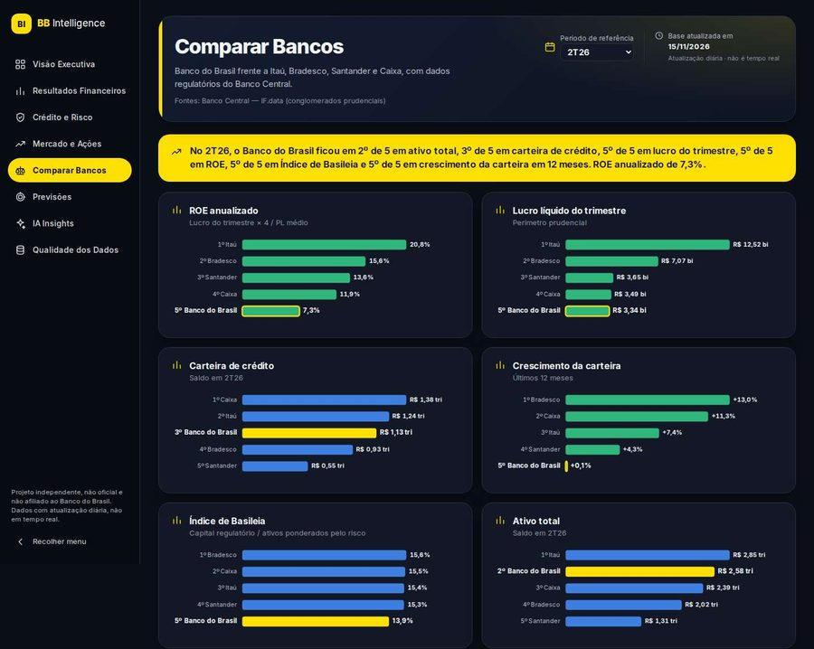
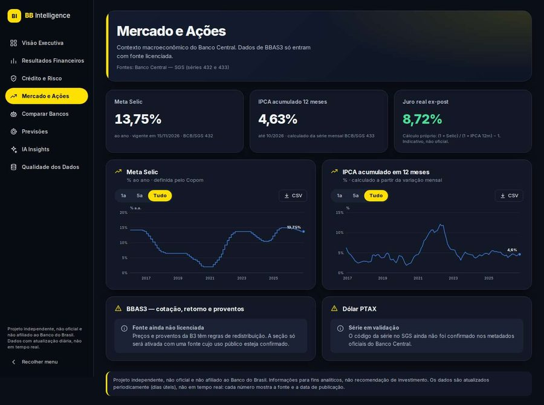
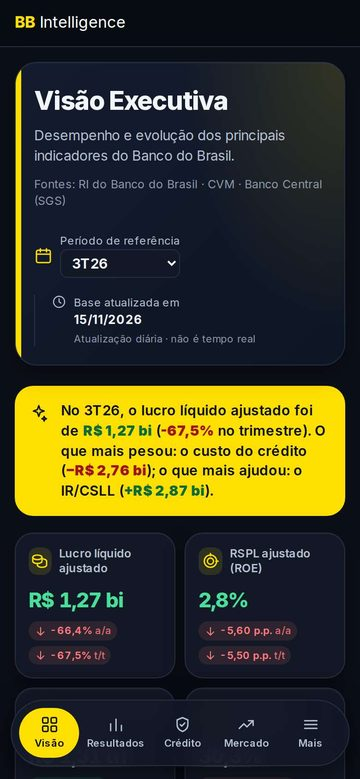
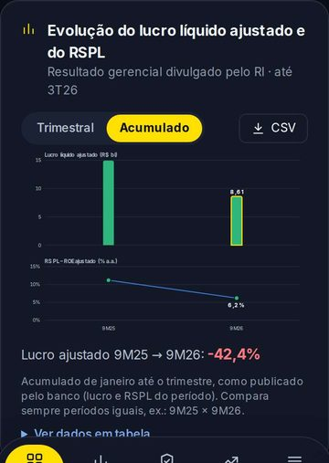

# BB Intelligence

**Inteligência financeira sobre o Banco do Brasil, construída só com dados públicos e auditáveis.**

[](https://github.com/erickkamorim/bb-intelligence/actions/workflows/ci.yml)
[](https://github.com/erickkamorim/bb-intelligence/actions/workflows/e2e.yml)
[](https://github.com/erickkamorim/bb-intelligence/actions/workflows/etl.yml)

**[Abrir o site →](https://bb-intelligence-lilac.vercel.app)** · [API](https://bb-intelligence-api.onrender.com/docs) · [Fontes e validação](docs/FONTES.md) · [Guia de desenvolvimento](docs/DESENVOLVIMENTO.md)

> Projeto independente, não oficial e não afiliado ao Banco do Brasil. Informações para fins analíticos, não recomendação de investimento. Dados com atualização periódica, não em tempo real.



---

## O problema

O resultado de um banco está espalhado em PDFs de 300 páginas, planilhas da CVM e séries do Banco Central. E cada fonte mede o lucro de um jeito: **o lucro "ajustado" do release, o lucro contábil da CVM e o lucro regulatório do Banco Central são três números diferentes**. Dashboards que misturam esses números parecem completos, mas enganam.

O BB Intelligence junta essas fontes num só lugar, **sem misturar o que não é comparável**, e responde a perguntas de negócio:

| Pergunta | Onde a resposta aparece |
|---|---|
| Por que o lucro caiu no trimestre? | **Ponte do lucro**: cada linha da DRE gerencial, do trimestre anterior ao atual, com verificação de que a soma fecha com o número divulgado |
| O que piorou ou melhorou fora do normal? | **Alertas automáticos** com polaridade por indicador (inadimplência subir é ruim, receita subir é bom) |
| Como o BB se compara a Itaú, Bradesco, Santander e Caixa? | **Comparar Bancos**: ROE, lucro, carteira, crescimento, Basileia e ativo, com ranking |
| Qual o risco da carteira de crédito? | **Crédito e Risco**: segmentos, inadimplência acima de 90 dias e cobertura |
| Esse número é confiável? | **Cada número mostra fonte, tabela/página e data de publicação**; a aba Qualidade dos Dados mostra cobertura e o histórico das cargas |

## Destaques técnicos

- **Rastreabilidade de ponta a ponta.** Toda observação no banco aponta para o documento de origem (URL, hash SHA-256, tabela e página). O site mostra essa fonte em cada número.
- **Lucro contábil × gerencial × regulatório.** Os três são guardados com escopo explícito e nunca aparecem como se fossem o mesmo indicador.
- **Validações que bloqueiam a carga.** A soma dos trimestres precisa bater com o acumulado do ano; a ponte do lucro precisa fechar; códigos de conta da CVM são conferidos pela descrição (se o plano de contas mudar, a carga para em vez de gravar errado).
- **Revisões versionadas.** Se a fonte reapresenta um número, ele entra como nova revisão; o histórico não é sobrescrito.
- **Períodos sem ambiguidade.** Trimestre isolado, acumulado no ano, exercício e saldo têm tipo próprio. O 4º trimestre (que a CVM não publica separado) é calculado e marcado como derivado.
- **Ausência explícita.** Indicador sem dado aparece como "sem dado", nunca como zero ou estimativa.
- **Acessível e responsivo.** Navegação por teclado, tabela alternativa em todo gráfico, cores validadas para daltonismo e verde/vermelho sempre acompanhados de sinal (+/−).

## Arquitetura

```mermaid
flowchart LR
  subgraph Fontes oficiais
    CVM[CVM Dados Abertos<br/>ITR e DFP]
    SGS[Banco Central SGS<br/>Selic e IPCA]
    IFD[Banco Central IF.data<br/>pares]
    RI[Releases do RI do BB<br/>curadoria com página]
  end
  subgraph ETL Python — GitHub Actions, dias úteis
    D[Download versionado<br/>+ SHA-256]
    V[Normalização<br/>e validação]
  end
  DB[(PostgreSQL<br/>Neon)]
  API[FastAPI<br/>Render]
  WEB[Next.js<br/>Vercel]
  CVM --> D
  SGS --> D
  IFD --> D
  RI --> V
  D --> V --> DB --> API --> WEB
```

| Camada | Tecnologia |
|---|---|
| ETL | Python, pandas, requests · jobs idempotentes · agendado no GitHub Actions |
| Banco | PostgreSQL (Neon) · SQLAlchemy 2 · migrations com Alembic |
| API | FastAPI · respostas com `data` + `meta` (fonte, período, unidade, aviso) |
| Frontend | Next.js 15 (App Router) · React 19 · TypeScript · gráficos em SVG próprio |
| Qualidade | pytest (parsers, validação, API) · build e tipagem no CI · teste ponta a ponta com o banco real e capturas de tela |
| Deploy | Vercel (site) · Render (API) · Neon (banco) — todos em plano gratuito |

## Telas

| Resultados Financeiros | Crédito e Risco |
|---|---|
|  |  |
| **Comparar Bancos** | **Mercado e Ações** |
|  |  |

<p align="center">
  
  &nbsp;&nbsp;
  
</p>

## Fontes de dados

| Fonte | O que entra | Como |
|---|---|---|
| [CVM — Dados Abertos](https://dados.cvm.gov.br/) (ITR/DFP) | Lucro contábil consolidado e dos controladores, ativo, patrimônio | Automático; licença ODbL |
| [Banco Central — SGS](https://dadosabertos.bcb.gov.br/) | Meta Selic, IPCA mensal (IPCA 12m calculado) | Automático, com novas tentativas em caso de falha |
| [Banco Central — IF.data](https://www3.bcb.gov.br/ifdata/) | BB, Itaú, Bradesco, Santander e Caixa (conglomerados prudenciais) | Automático |
| [RI do Banco do Brasil](https://ri.bb.com.br/) | Lucro ajustado, RSPL, eficiência, carteira por segmento, inadimplência, DRE gerencial | Curadoria manual validada: cada linha exige link oficial e página |

Detalhes da validação de cada fonte em [docs/FONTES.md](docs/FONTES.md).

## Rodar localmente

```bash
docker compose up -d db
cd backend && pip install -r requirements-dev.txt
alembic upgrade head && python -m etl seed && pytest -q
uvicorn app.main:app --reload          # API em http://localhost:8000/docs

cd ../frontend && npm install && npm run dev   # site em http://localhost:3000
```

Passo a passo completo, variáveis de ambiente e comandos do ETL em [docs/DESENVOLVIMENTO.md](docs/DESENVOLVIMENTO.md).

## Próximos passos

- Histórico do lucro ajustado do 4T25 e do 1T26 (depende dos releases desses trimestres)
- Provisões e perda esperada por segmento
- **Previsões** com backtesting temporal e intervalos, sem apresentar previsão como certeza
- **IA Insights**: perguntas em linguagem natural respondidas só a partir dos dados e documentos carregados, com citação
- BBAS3 (cotação e proventos) quando houver fonte com licença de redistribuição

## Autor

**Erick Amorim** — Logística & Dados · [github.com/erickkamorim](https://github.com/erickkamorim)
